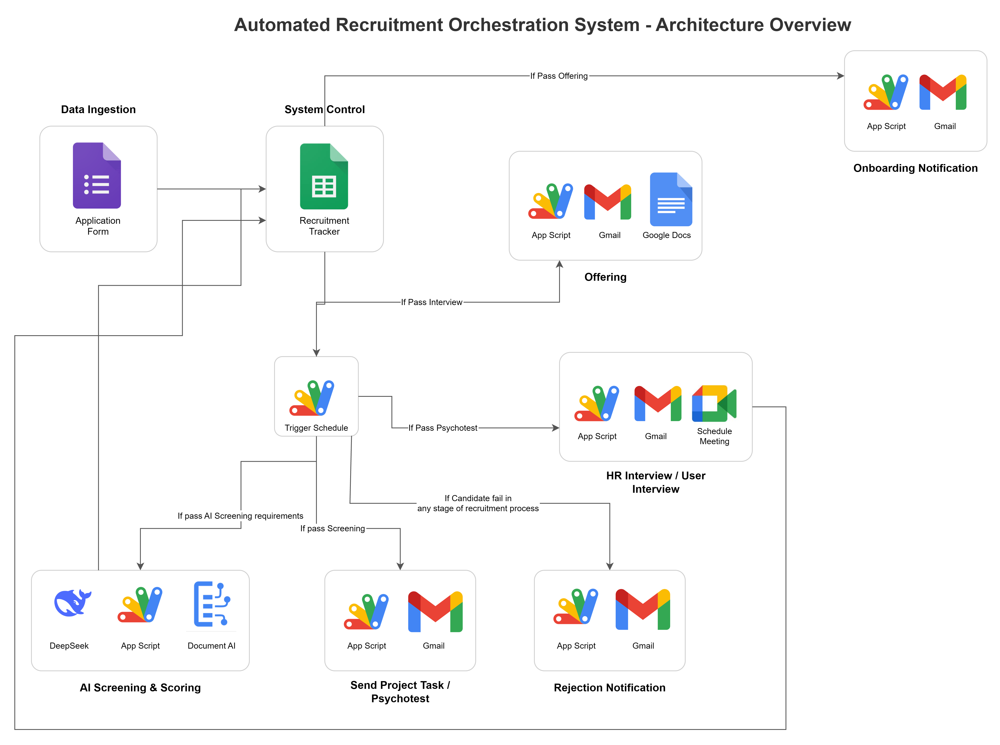

# Recruitment Automation



An end-to-end recruitment automation project built with Google Apps Script, Google Sheets, Google Drive, Gmail, Google Calendar, and Python utilities.

## Workflow

```text
Bulk candidate upload
        ↓
CV parsing and screening
        ↓
Candidate scoring
        ↓
Project task passed → online interview invitation
        ↓
Interview passed → offer letter sent
        ↓
Returned offer letter → welcome email and onboarding
```

## Project structure

All Apps Script files are located in `src/App Script/`.

| File | Purpose |
| --- | --- |
| `Code.js` | Custom menu and script configuration checks |
| `BulkUpload.js` | Bulk candidate data upload |
| `Parser.js` | CV retrieval and parsing from Google Drive |
| `Scoring.js` | Candidate scoring based on criteria and master data |
| `Screening_Pass.js` | Sends screening-pass emails |
| `Project_Task_Pass.js` | Sends project-task and online-interview invitations |
| `Mail_Merge.js` | Creates offer letters from a Google Docs template and exports them as PDF |
| `Interview_Pass.js` | Sends offer letters to candidates who pass the interview |
| `Offering_Pass.js` | Sends confirmation after a returned offer letter is received |
| `Fail_Notification.js` | Sends fail notifications for Screening, Project Task, Interview, and Offering stages |
| `appsscript.json` | Runtime, timezone, and OAuth scopes |
| `.clasp.json` | clasp deployment configuration |

## Spreadsheet structure

### Recruitment sheet

| Column | Data |
| --- | --- |
| A | Candidate code / key |
| C | Candidate name |
| D | Position |
| G | Candidate email |
| L | Interview status |
| M | Interview-pass email timestamp |
| N | Returned-offer / final-pass status |
| O | Welcome-email timestamp |

### Offering sheet

Used by `Mail_Merge.js` to generate offer letters. Column A is the candidate key and column L stores the generated PDF link.

## Email conditions

The automation prevents duplicate emails by checking the corresponding timestamp column.

- `Project_Task_Pass.js`: project-task status is `Pass` and the send timestamp is empty.
- `Interview_Pass.js`: Recruitment column L is `Pass` and column M is empty. The offer letter is retrieved from the Offering sheet and sent as a PDF attachment.
- `Offering_Pass.js`: Recruitment column N is `Pass` and column O is empty. The successful send timestamp is written to column O.
- `Fail_Notification.js`: the stage status is `Fail` and the corresponding timestamp column is empty. The timestamp is written only after the notification is sent successfully.

## Email examples

### Pass notification

Pass emails explain the successful stage result and the next action required from the candidate.


### Fail notification

Fail emails confirm the stage where the application ends and thank the candidate for their interest.


## Offering Pass email

The email confirms receipt of the candidate's returned offer letter and includes a welcome message, onboarding information, expected start-date information, and administrative document requirements.

## Configuration

1. Open the Google Apps Script project connected to the recruitment spreadsheet.
2. Ensure the `Recruitment` and `Offering` sheets use the expected columns.
3. Ensure the logo, templates, and Drive folders are accessible to the executing account.
4. Verify Drive file and folder IDs before deployment.
5. Store external API keys in Script Properties instead of source code.
6. Authorize the OAuth scopes declared in `appsscript.json`.

## Running the project

Run the required function from the Apps Script editor:

```text
processBulkUpload()
processSheet()
scoreAllCandidates()
sendScreeningPass()
sendPJTaskPass()
createOfferingLetter()
sendInterviewPass()
sendOfferingPass()
sendFailNotifications()
```

For clasp deployments:

```bash
clasp push
clasp open
```

## Operational notes

- Test with a small number of candidates before running a bulk process.
- Use the exact status value `Pass`.
- Check Apps Script Executions and Logs when a row is skipped or an email fails.
- Do not clear a send timestamp unless a deliberate resend is required.
- Keep API keys, tokens, and personal candidate data out of version control.

## Timezone

The Apps Script project uses `Asia/Jakarta`, as defined in `appsscript.json`.
