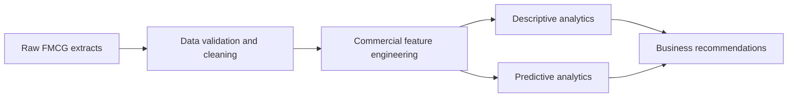

# FMCG Commercial Intelligence & Predictive Analytics

## Overview

An FMCG analytics project that combines sales, inventory, outlet, promotion, customer, and distributor data to support commercial decision-making and predictive analysis.

## Key Features & Impact

- Consolidates transactional and master data from multiple FMCG domains.
- Supports sales performance, promotion effectiveness, outlet, inventory, and customer analysis.
- Provides a foundation for demand, uplift, and commercial forecasting use cases.
- Keeps raw source extracts separated from analytical outputs for reproducibility.

## Tech Stack

- Python and analytical notebooks/scripts
- CSV-based raw data extracts
- Pandas and statistical or machine-learning workflows
- Git-based project versioning

## Architecture & Data Flow



## Repository Structure

```text
├── data/raw/                  # Source FMCG extracts
├── notebooks/                 # Exploratory and modeling notebooks, when included
├── src/                       # Reusable analysis code, when included
├── reports/                   # Generated outputs, when included
└── README.md                  # Project documentation
```

## Data Privacy

Use anonymized or synthetic data for portfolio demonstrations. Do not commit personal, confidential, or production commercial data.
